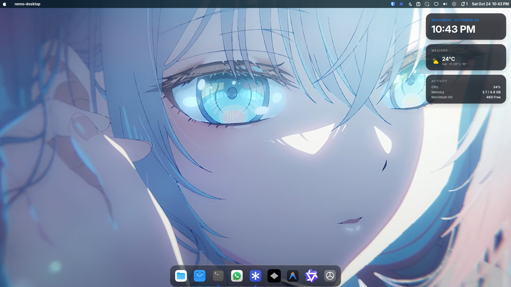

# macOS Tahoe 26 (Liquid Glass) on Linux Mint

[](https://linuxmint.com/)
[](https://apple.com)
[](LICENSE)

Transform **Linux Mint (Cinnamon Edition)** into a pixel-perfect, minimalist replica of **macOS Tahoe 26 ("Liquid Glass")**.

This guide covers everything **from the absolute basics**—from system packages and theme engines to hardware-accelerated GLSL rounded window shaders, custom Cinnamon applets, high-DPI cursors, an authentic Apple menubar, and an engineered macOS clone dock.

---

## 📸 Desktop Preview



---

## ✨ Features & Highlights

- **Liquid Glass Shell**: 30px frosted dark menubar with an authentic Apple logo vector, dynamic active application title, custom macOS Tahoe Control Center, and native-styled systray.
- **Engineered macOS Clone Dock**:
  - Dark frosted glass theme with 22px rounded corners and tight borders.
  - Native macOS running indicators (crisp running dots only).
  - Elementary OS rectangular active glow completely removed via runtime hook (`libplank-noglow.so`).
  - Pre-cached PNG icons resolving librsvg timeouts and preventing blurry downscaling.
  - Intelligent auto-dodge allowing maximized windows to span the full screen while gliding up over windows when hovering the bottom edge.
  - Managed under a persistent `systemd --user` service with auto-recovery.
- **Hardware-Accelerated Window Curves**: Real 14px rounded corners and drop shadows rendered via Clutter GLSL shaders (`RoundedCorners@klangman`), plus GTK 3/4 CSS curves.
- **Bento Desktop Widgets**: Live Clock/Calendar, real-time CPU/RAM/SSD telemetry, and Weather cards.
- **Spotlight Search**: Ulauncher styled with a custom macOS Tahoe translucent bento palette.
- **Mac Keyboard Shortcuts**: Native macOS keybindings (`Super + Space` for Spotlight, `Super + Q` to close windows, `Super + Tab` switcher).
- **Apple Boot Screen**: Plymouth boot splash featuring the high-DPI vector Apple mark on deep AMOLED black with a macOS progress bar.

---

## ⚡ Quick Start (Automated Install)

Clone the repository and run the automated setup script:

```bash
git clone https://github.com/Sarthak-Cyb3r/macos-tahoe-linux-mint.git
cd macos-tahoe-linux-mint
chmod +x install.sh
./install.sh
```

> **Note**: To configure system-level login screens (LightDM Slick-Greeter) and the Plymouth Apple boot screen, execute with sudo:
> ```bash
> sudo ./install.sh
> ```

To revert all changes back to your exact default Mint desktop at any time:
```bash
./rollback.sh
```

---

## 🛠️ Complete Step-by-Step Guide (From Basics)

If you prefer to configure your system manually or understand how each layer works, follow the steps below from start to finish.

### 1. Prerequisites & Dependencies

Install the core build tools, theme engines, dock, and launcher utilities:

```bash
sudo apt update
sudo apt install -y \
    git curl wget gcc make libglib2.0-dev libcairo2-dev \
    plank ulauncher plymouth-themes slick-greeter-slick-key \
    dconf-cli jq fonts-inter fonts-jetbrains-mono
```

---

### 2. Wallpaper & Authentic Apple Vectors

Download the official 5K Tahoe wallpaper and deploy the geometric Apple silhouette:

```bash
mkdir -p ~/.local/share/backgrounds ~/.local/share/icons

# 5K Tahoe Wallpaper
wget -q -O ~/.local/share/backgrounds/macOS-Tahoe-5K.jpg \
    "https://raw.githubusercontent.com/vinceliuice/WhiteSur-wallpapers/main/4k/WhiteSur-dark.jpg"
gsettings set org.cinnamon.desktop.background picture-uri "file://$HOME/.local/share/backgrounds/macOS-Tahoe-5K.jpg"
gsettings set org.cinnamon.desktop.background picture-options "zoom"

# Deploy Crisp 22x22 Apple Menu Vector
cp assets/apple-menu.svg ~/.local/share/icons/apple-menu.svg
cp assets/apple-logo.svg ~/.local/share/icons/apple-logo.svg
```

---

### 3. GTK 3/4, Shell & Metacity Themes

Install WhiteSur GTK and Shell themes:

```bash
git clone https://github.com/vinceliuice/WhiteSur-gtk-theme.git /tmp/WhiteSur-gtk
cd /tmp/WhiteSur-gtk
./install.sh -c Dark -s standard -t default -N glassy --libadwaita
cd ~ && rm -rf /tmp/WhiteSur-gtk

# Apply via GSettings
gsettings set org.cinnamon.desktop.interface gtk-theme 'WhiteSur-Dark'
gsettings set org.cinnamon.desktop.wm.preferences theme 'WhiteSur-Dark'
gsettings set org.cinnamon.theme name 'WhiteSur-Dark'

# Left-side macOS Traffic Lights (Close, Minimize, Maximize)
gsettings set org.cinnamon.desktop.wm.preferences button-layout 'close,minimize,maximize:'
```

---

### 4. Icon Theme & High-DPI macOS Cursors

```bash
# WhiteSur Icons
git clone https://github.com/vinceliuice/WhiteSur-icon-theme.git /tmp/WhiteSur-icons
cd /tmp/WhiteSur-icons
./install.sh -a -b
cd ~ && rm -rf /tmp/WhiteSur-icons

# WhiteSur macOS Cursors (Anti-aliased, zero alpha noise)
git clone https://github.com/vinceliuice/WhiteSur-cursors.git /tmp/WhiteSur-cursors
mkdir -p ~/.local/share/icons
cp -r /tmp/WhiteSur-cursors/dist/WhiteSur-cursors ~/.local/share/icons/
cd ~ && rm -rf /tmp/WhiteSur-cursors

# Apply Icons and Cursors
gsettings set org.cinnamon.desktop.interface icon-theme 'WhiteSur-dark'
gsettings set org.cinnamon.desktop.interface cursor-theme 'WhiteSur-cursors'
gsettings set org.cinnamon.desktop.interface cursor-size 24
```

---

### 5. System-wide Rounded Corners (Hardware GLSL)

Cinnamon native borders are square. To obtain true macOS rounded corners across all windows, install `RoundedCorners@klangman`:

```bash
SPICES_DIR="$HOME/.local/share/cinnamon/extensions/RoundedCorners@klangman"
mkdir -p "$SPICES_DIR"
git clone https://github.com/klangman/RoundedCorners.git /tmp/RoundedCorners
cp -r /tmp/RoundedCorners/RoundedCorners@klangman/* "$SPICES_DIR/"
rm -rf /tmp/RoundedCorners

# Configure 14px curvature and soft shadows
cat << 'EOF' > "$HOME/.config/cinnamon/spices/RoundedCorners@klangman.json"
{
    "cornerRadius": { "type": "spinbutton", "value": 14 },
    "shadowEnabled": { "type": "checkbox", "value": true },
    "shadowRadius": { "type": "spinbutton", "value": 16 },
    "shadowOpacity": { "type": "spinbutton", "value": 0.35 }
}
EOF

# Enable Extension
gsettings set org.cinnamon enabled-extensions "['RoundedCorners@klangman']"
```

---

### 6. macOS Menu Bar (Top Bar & Apple Logo)

1. **Move Cinnamon Panel to Top & Set Height to 30px**:
   ```bash
   gsettings set org.cinnamon panels-enabled "['1:0:top']"
   gsettings set org.cinnamon panels-height "['1:30']"
   ```
2. **Configure Left Apple Menu Applet**:
   ```bash
   python3 -c '
   import json, os
   p = os.path.expanduser("~/.config/cinnamon/spices/menu@cinnamon.org/0.json")
   if os.path.exists(p):
       with open(p, "r") as f: d = json.load(f)
       d["menu-custom"]["value"] = True
       d["menu-icon"]["value"] = os.path.expanduser("~/.local/share/icons/apple-menu.svg")
       d["menu-icon-size"]["value"] = 18
       d["menu-label"]["value"] = ""
       with open(p, "w") as f: json.dump(d, f, indent=4)
   '
   ```

---

### 7. Engineered macOS Clone Dock (Plank)

Plank provides the closest fluid animation and behavior to the macOS dock, but default themes suffer from three major issues on modern systems:
1. **Elementary OS Active Glow**: Draws a harsh rectangular backlight behind the active/focused application window.
2. **Slow Librsvg SVG Parsing**: Causes Plank to exceed its 30ms render deadline and aggressively downscale icons into blurry bitmaps.
3. **Desktop Visibility vs Application Overlap**: Standard settings either permanently block screen real-estate or hide on the desktop.

#### Solution 1: Active Glow Suppression Hook (`libplank-noglow.so`)
Compile and install the runtime interceptor:

```bash
cd src
make
make install
cd ..
```

The hook safely patches the entry instruction of `plank_dock_theme_draw_active_glow` in memory to `ret` (`0xc3`). This completely eliminates the elementary OS active backlight rectangle without touching running indicator dots.

#### Solution 2: Pre-rendered High-Res Dock Icons
Pre-render crisp 128x128 PNG icons into `~/.local/share/icons/mac-dock/` and assign them to matching `.desktop` launchers to ensure instant surface rasterization.

#### Solution 3: Liquid Glass Theme & Systemd Supervisor
Create the theme in `~/.local/share/plank/themes/Liquid-Glass/dock.theme`:

```ini
[PlankTheme]
TopRoundness=22
BottomRoundness=22
LineWidth=1
OuterStrokeColor=255;;255;;255;;25
FillStartColor=44;;48;;58;;155
FillEndColor=22;;25;;32;;185
InnerStrokeColor=255;;255;;255;;55

[PlankDockTheme]
HorizPadding=1
TopPadding=3
BottomPadding=3
ItemPadding=4
IndicatorSize=4
IconShadowSize=0
UrgentBounceHeight=1.8
LaunchBounceHeight=1.0
FadeOpacity=1
ClickTime=250
UrgentBounceTime=0
LaunchBounceTime=500
ActiveTime=300
SlideTime=120
FadeTime=180
HideTime=150
GlowSize=0
GlowTime=0
GlowPulseTime=0
UrgentHueShift=150
ItemMoveTime=180
CascadeHide=true
BadgeColor=255;;255;;255;;240
```

Configure Plank via `dconf`:
```bash
dconf write /net/launchpad/plank/docks/dock1/theme "'Liquid-Glass'"
dconf write /net/launchpad/plank/docks/dock1/hide-mode "'intelligent'"
dconf write /net/launchpad/plank/docks/dock1/icon-size 50
dconf write /net/launchpad/plank/docks/dock1/zoom-enabled true
dconf write /net/launchpad/plank/docks/dock1/zoom-percent 125
dconf write /net/launchpad/plank/docks/dock1/show-dock-item false
dconf write /net/launchpad/plank/docks/dock1/unhide-delay 0
dconf write /net/launchpad/plank/docks/dock1/hide-delay 150
```

Enable persistence via `systemd --user`:
```bash
mkdir -p ~/.config/systemd/user
cat << 'EOF' > ~/.config/systemd/user/plank.service
[Unit]
Description=Plank macOS Dock
PartOf=graphical-session.target
After=graphical-session.target

[Service]
Type=simple
Environment=DISPLAY=:0
Environment=XAUTHORITY=%h/.Xauthority
Environment=LD_PRELOAD=%h/.local/lib/libplank-noglow.so
ExecStart=/usr/bin/plank
Restart=always
RestartSec=1

[Install]
WantedBy=default.target
EOF

systemctl --user daemon-reload
systemctl --user enable --now plank.service
```

---

### 8. Spotlight Search & Keyboard Shortcuts

Install and configure Ulauncher with custom macOS Tahoe bento colors:

```bash
mkdir -p ~/.config/ulauncher/user-themes/macOS-Tahoe
cat << 'EOF' > ~/.config/ulauncher/user-themes/macOS-Tahoe/manifest.json
{
  "name": "macOS-Tahoe",
  "display_name": "macOS Tahoe 26",
  "matched_text": { "color": "#0A84FF" }
}
EOF

# Bind Super + Space to Spotlight
gsettings set org.cinnamon.desktop.keybindings.custom-keybinding:/org/cinnamon/desktop/keybindings/custom-keybindings/custom0/ name 'Spotlight'
gsettings set org.cinnamon.desktop.keybindings.custom-keybinding:/org/cinnamon/desktop/keybindings/custom-keybindings/custom0/ command 'ulauncher-toggle'
gsettings set org.cinnamon.desktop.keybindings.custom-keybinding:/org/cinnamon/desktop/keybindings/custom-keybindings/custom0/ binding "['<Super>space']"

# Mac Window Controls
gsettings set org.cinnamon.desktop.keybindings.wm close "['<Super>q', '<Alt>F4']"
gsettings set org.cinnamon.desktop.keybindings.wm switch-to-workspace-left "['<Control><Super>Left']"
gsettings set org.cinnamon.desktop.keybindings.wm switch-to-workspace-right "['<Control><Super>Right']"
```

---

## ⌨️ Mac Keyboard Shortcuts Reference

| Shortcut | macOS Equivalent | Action |
| :--- | :--- | :--- |
| `Super + Space` | `Cmd + Space` | Spotlight Search (Apps, Files, Math) |
| `Super + Q` | `Cmd + Q` | Close / Quit active window |
| `Super + Tab` | `Cmd + Tab` | macOS-style App Switcher |
| `Super + D` | `Cmd + F3` | Show Desktop / Minimize All |
| `Super + Up` | `Ctrl + Cmd + F` | Maximize window |
| `Super + Down` | `Cmd + M` | Unmaximize / Restore window |

---

## 🔬 Technical Deep Dive: Plank Active Glow Elimination

Plank (from the elementary OS project) was architected to render a colored gradient backlight behind whichever application window is currently active. In `libplank.so.1`, this behavior is handled by:

```c
void plank_dock_theme_draw_active_glow(PlankDockTheme *self,
                                      PlankSurface *surface,
                                      GdkRectangle *rect,
                                      GdkRectangle *rect2,
                                      GdkRGBA *color,
                                      GtkPositionType position,
                                      double progress);
```

Because `plank_dock_theme_draw_active_glow` is called whenever an active launcher is rendered—regardless of theme settings—setting `ActiveTime=0` in `dock.theme` creates a floating-point division by zero (`elapsed / 0.0 = +inf`), which causes Plank to clamp `progress` to `1.0` and permanently display the active glow rectangle at 100% opacity.

Our lightweight hook ([`src/libplank-noglow.c`](src/libplank-noglow.c)) loads via `LD_PRELOAD`:

```c
#define _GNU_SOURCE
#include <dlfcn.h>
#include <sys/mman.h>
#include <unistd.h>
#include <stdint.h>

__attribute__((constructor))
static void init_noglow(void) {
    void *fn = dlsym(RTLD_DEFAULT, "plank_dock_theme_draw_active_glow");
    if (!fn) return;

    long pagesize = sysconf(_SC_PAGESIZE);
    uintptr_t page_start = (uintptr_t)fn & ~(pagesize - 1);

    if (mprotect((void *)page_start, pagesize, PROT_READ | PROT_WRITE | PROT_EXEC) == 0) {
        *(unsigned char *)fn = 0xc3; // x86_64 'ret' instruction
        mprotect((void *)page_start, pagesize, PROT_READ | PROT_EXEC);
    }
}
```

By atomically patching the entry byte of `plank_dock_theme_draw_active_glow` to `0xc3` (`ret`) during process initialization, the active glow is bypassed with zero runtime overhead while retaining all other dock rendering, including the running indicator dots.

---

## 🔄 Uninstallation & Safe Rollback

To restore Linux Mint to its default baseline state:

```bash
./rollback.sh
```

The rollback script automatically:
1. Restores all original GSettings and dconf keys from the baseline backup.
2. Restores default panel positioning and standard Mint applets.
3. Re-enables the default Mint-Y / Mint-X themes, cursors, and icons.
4. Stops and disables the `plank.service` systemd unit.
5. Removes custom applets, desklets, and Ulauncher themes.
6. Replaces the Plymouth Apple splash screen with the stock Linux Mint plymouth theme.

---

## 📄 License

This project is licensed under the [MIT License](LICENSE).
Wallpapers, cursors, and icon themes belong to their respective creators (WhiteSur by [vinceliuice](https://github.com/vinceliuice)).
